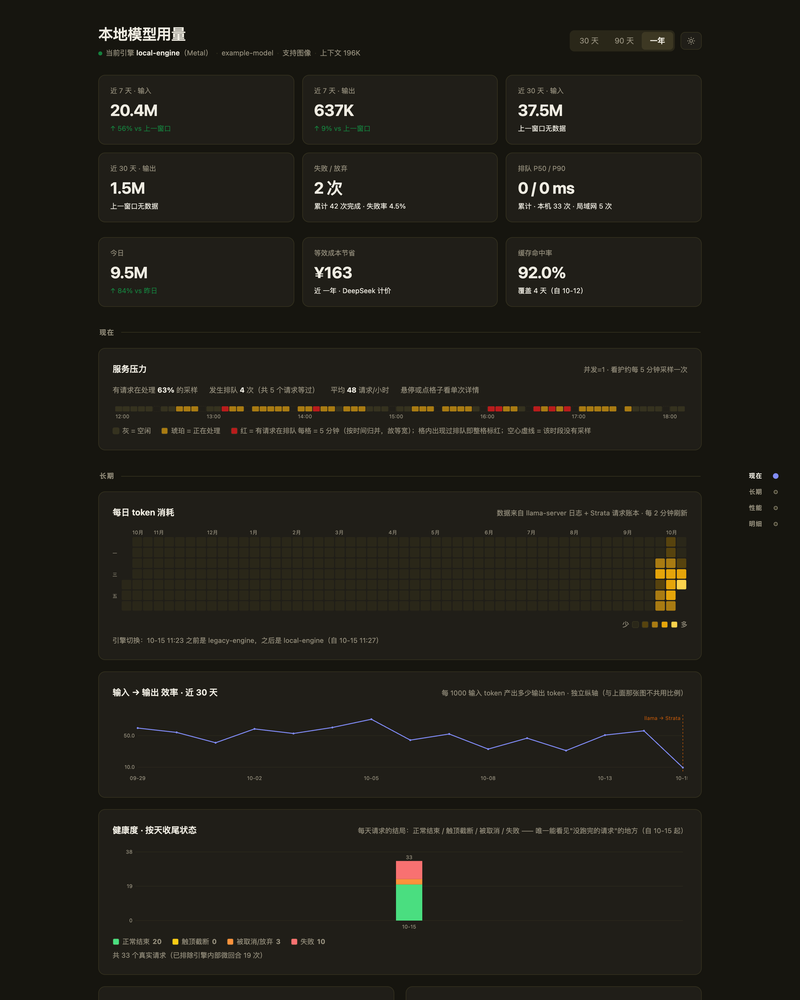
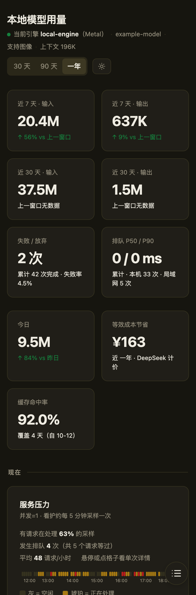

<div align="center">

# llm-usage-dashboard

**A zero-dependency dashboard for local LLM usage — tokens, throughput, context, health, per-source attribution.**

**零依赖的本地 LLM 用量看板：token / 吞吐 / 上下文 / 健康度 / 来源归属。**

[](LICENSE)
[](#architecture)
[](#architecture)
[](#architecture)




<sub>Sample data (<code>data.sample.json</code>) — sanitized, not real traffic.</sub>

</div>

---

**English** | [中文](#中文文档)

## What this is

A single-page dashboard for a **self-hosted LLM inference server** (llama.cpp, or anything speaking the
same API). No framework, no build step, no CDN: `index.html` draws its own SVG, and `aggregate_all.py`
(pure Python standard library) turns engine logs and a request ledger into one `data.json`.

## Blind spots it closes

Most local-LLM setups can tell you *how many tokens* were processed. This dashboard also answers
**who**, **what failed**, and **what was slow**:

| Blind spot | How it is handled |
|---|---|
| You know token totals, not **who used the service** | The serving wrapper books every finished turn with its source (localhost / LAN / tunnel), peer address, User-Agent and queue depth — captured **at the moment the queue gate grants the turn**, because capturing at request-arrival mixes peers up under concurrency |
| **Failed requests are invisible** | Every response, including 4xx/5xx and clients that walk away, is booked at the single response exit. The health panel stacks four outcomes per day: completed / truncated / cancelled / failed |
| **One spike flattens the y-axis** | Throughput charts use a **logarithmic** y-axis (1-2-5 ladder, ticks filtered by *pixel* distance rather than by decade). Measured: the normal band's pixel span rose from 17.6% to 50% of the chart height |
| Input:output is ~100:1, so **the small one vanishes in a shared bar** | Separate charts, separate scales, plus a dedicated ratio curve. That is geometry — no palette fixes it |
| An engine swap changes the **measurement caliber**, and the curve reads like a regression | The ratio curve is annotated with the swap point: engines count prompt tokens differently (actually read vs. including cache reuse). The jump is real, not a bug |
| On a single-sequence engine, **"slow" is not low t/s — it is holding the only slot** | The "peaks and tail" panel lists the slowest requests **by occupancy time**. Hung or failed requests have no t/s at all, so they can never appear in a "fastest" list — this is the only place they show up |

## Architecture

```
engine log / metrics ─┐
                      ├─► aggregate_all.py ──► data.json ──► index.html
per-source ledger ────┘     (stdlib only)      (atomic write)  (hand-rolled SVG)
```

- The **detail ledger** is append-only JSONL; the serving wrapper appends one line per finished request.
- **Daily rollups** live in SQLite (`usage.db`), decoupled from detail retention: capping the detail file at
  N days later cannot lose history. A database rather than a JSON file because of atomicity — a
  "read-all → modify → overwrite" JSON leaves a half-written file if the process is killed.
- The page refetches `data.json` every 2 minutes; the aggregator writes it atomically (temp file + `os.replace`).

## Quick start

```bash
cp data.sample.json data.json       # try it with the sanitized sample first
python3 -m http.server 18081        # open http://127.0.0.1:18081/
python3 aggregate_all.py            # once you have real data, rebuild data.json
```

`data.sample.json` is produced by `tools/make_sample.py` using a **whitelist rebuild**: only the fields the
page actually reads are copied into a fresh object, instead of "copy everything, then delete the sensitive
bits". A copy-and-delete script leaks the moment it misses one nested field (a peer address, a User-Agent,
a path). Peer addresses are mapped to RFC 5737 documentation ranges (`192.0.2.x`, `198.51.100.x`,
`203.0.113.x`) and all counts are scaled. Real `data.json`, ledgers, logs and databases are in `.gitignore`.

## Plugging in your own engine

Aggregation has two halves: `aggregate.py` parses llama.cpp's `slot print_timing` log lines (history), and
`aggregate_all.py` merges the new engine's request ledger. To onboard an engine, just emit the same ledger
rows:

```json
{"ts": "2026-10-15T17:16:02", "source": "local", "peer": "127.0.0.1", "ua": "node",
 "wait_ms": 0, "hold_ms": 4800, "prompt_tokens": 35061, "generated": 239, "reused": 34000,
 "drafts_accepted": 14, "drafts_offered": 25, "prompt_ms": 1750.7, "decode_ms": 4053.8,
 "finish": "stop", "http_status": 200}
```

Path constants live at the top of `aggregate_all.py`; the API-key file can be overridden with
`LLM_API_KEY_FILE` and the engine URL with `STRATA_URL`.

## Notes

The code comments record each pitfall and *why* it is that way — cache counter semantics, 0 ms ghost rows,
outlier spikes, and narrow-screen viewBox downscaling that turns axis labels into mush. Read them before
changing behaviour that looks more complicated than it needs to be.

MIT License.

---

## 中文文档

## 这是什么

一个 **自托管 LLM 推理服务**（llama.cpp 或任何同类 API）的单页看板。没有框架、没有构建步骤、没有 CDN：
`index.html` 自己手写 SVG，`aggregate_all.py`（纯 Python 标准库）把引擎日志与请求账本聚合成一个 `data.json`。

## 它补的是哪些盲点

本地 LLM 服务通常只能说清"跑了多少 token"。这个看板还回答**谁在用**、**什么失败了**、**什么变慢了**：

| 盲点 | 做法 |
|---|---|
| 只知道总量，不知道**谁在用** | 服务包装层为每个完成的回合记账：来源（本机 / 局域网 / 隧道）、对端地址、UA、队列深度 —— 并且是在**队列闸门授予回合那一刻**采集的，因为按"请求到达时刻"采集在并发时会串号 |
| **没跑完的请求完全不可见** | 所有响应（含 4xx/5xx、客户端中途离开）统一在唯一出口记账。健康度面板按天堆叠四种结局：正常结束 / 触顶截断 / 被取消 / 失败 |
| **单个尖峰压平纵轴** | 吞吐图用**对数**纵轴（1-2-5 阶梯，且刻度按**像素间距**筛、而不是按数量级）。实测常态带的像素跨度从 17.6% 提到 50% |
| 输入:输出 ≈ 100:1，**画在同一根柱子里小的那端就消失了** | 各自成图、各自定标，另加一条比值曲线。这是几何决定的，换调色板救不了 |
| 换引擎会改变**计量口径**，曲线看起来像效率崩了 | 在比值曲线上标出切换点：不同引擎统计 prompt token 的方式不同（只算实读 vs 含缓存复用）。量级跳变是事实，不是 bug |
| 单序列引擎里 **"慢"不是 t/s 低，而是占住了唯一那一格** | 「峰值与长尾」按**占用时长**列出最慢的几次。卡死或失败的请求根本没有 t/s，永远进不了"最快榜"——这里是唯一能看到它们的地方 |

## 架构

```
引擎日志 / 指标 ─┐
                 ├─► aggregate_all.py ──► data.json ──► index.html
按来源请求账本 ──┘     (纯标准库)          (原子写回)    (手写 SVG，零依赖)
```

- **明细账本**是 append-only 的 JSONL，服务包装层每完成一次请求追加一行。
- **日汇总**落在 SQLite（`usage.db`），与明细清理解耦：将来明细只保留 N 天，历史日汇总也不会消失。
  用数据库而不是 JSON 文件是为了**原子性** —— "读全量 → 改 → 覆写"的 JSON 一旦在进程被杀时中断，就会留下半截文件。
- 页面每 2 分钟重取 `data.json`；聚合器用临时文件 + `os.replace` 原子写回。

## 快速开始

```bash
cp data.sample.json data.json       # 先用脱敏样片看效果
python3 -m http.server 18081        # 打开 http://127.0.0.1:18081/
python3 aggregate_all.py            # 有真实数据后重新聚合
```

`data.sample.json` 由 `tools/make_sample.py` 生成，采用**白名单重建**：只把页面确实需要的字段复制进
一个新对象，而不是"复制全部、再删敏感项"—— 后者只要漏掉一个嵌套字段（对端地址、UA、路径）就会泄漏。
对端地址映射到 RFC 5737 文档保留地址（`192.0.2.x` / `198.51.100.x` / `203.0.113.x`），计数统一缩放。
真实的 `data.json`、账本、日志、数据库都在 `.gitignore` 中。

## 接入你自己的引擎

聚合分两半：`aggregate.py` 解析 llama.cpp 的 `slot print_timing` 日志（历史），`aggregate_all.py`
合并新引擎的请求账本。接一个新引擎只需产出同样形状的账本行（见上方 JSON 示例）。

路径常量在 `aggregate_all.py` 顶部；密钥文件可用环境变量 `LLM_API_KEY_FILE` 覆盖，引擎地址用 `STRATA_URL`。

## 说明

代码注释里逐条记录了踩过的坑与原因（缓存计数器语义、0ms 幽灵行、掉速异常值、
窄屏 viewBox 被缩放导致轴标签糊成一片等）。改动前建议先读注释 —— 它们解释了
"为什么是这样，而不是看起来更直接的那样"。

MIT License.
